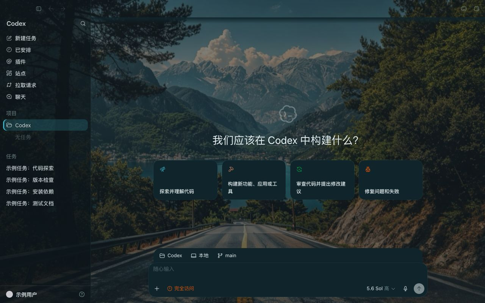
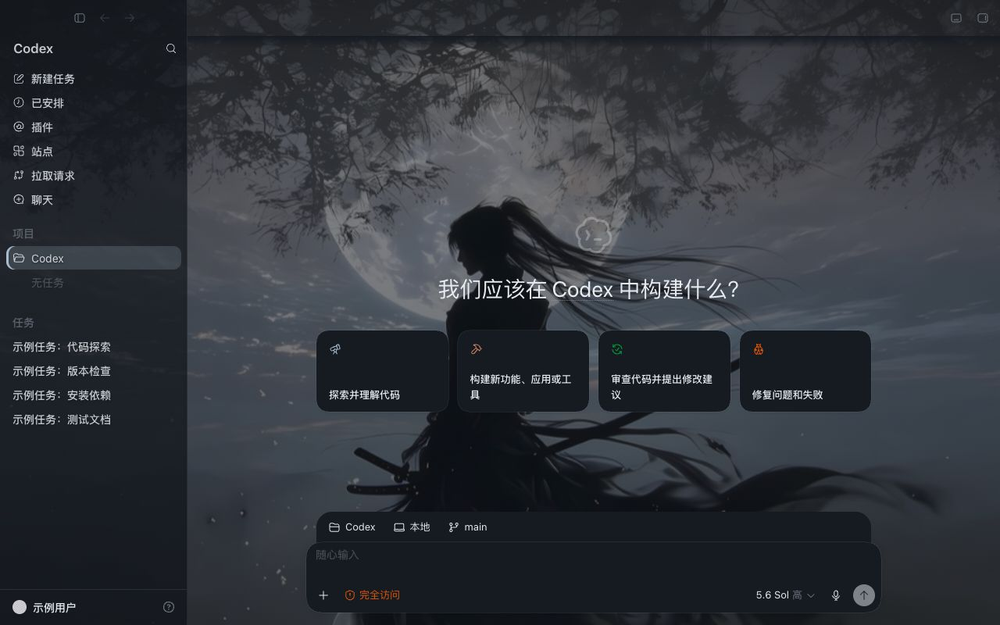
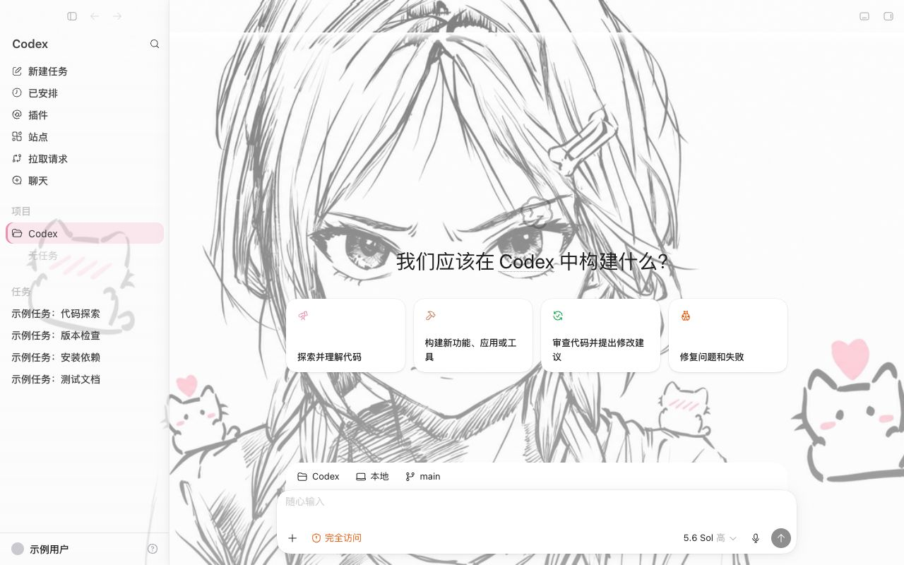

<div align="center">

# okkskin

### 给 Codex 桌面端换皮肤:一条命令,整套界面配色 + 壁纸

[](LICENSE)
[](https://nodejs.org)
[](#支持平台)
[](https://github.com/Okkmass/okkskin/pulls)
[](https://github.com/Okkmass/okkskin/stargazers)

中文 | [English](#english)

</div>

---

## 这是什么

Codex(ChatGPT 桌面端的 Codex)本身没有换肤入口。okkskin 让你从[皮肤库](https://www.okkmax.com/tools/skins)挑一款,在终端跑一条命令,Codex 的**整套界面配色 + 壁纸**就换好了。**不改 Codex 安装包、不动代码签名**,随时一键还原。

> **使用前请先知道**
> 新版 Codex 已关闭 Node 调试开关,旧的「向进程发信号」方式会让 Codex 直接闪退。0.3.0 起改为:**用 `okkskin launch` 启动 Codex**,启动时带上一个只监听本机 `127.0.0.1` 的调试口,okkskin 再通过它注入主题。
> 因此:**从 Dock / Launchpad 直接点开的 Codex 无法换肤**,要先退出,再用 `okkskin launch` 启动。调试口在 Codex 运行期间一直开着(见[安全](#安全))。
> 旧版 0.2.x 会让新版 Codex 闪退,请升级到 0.3.0。

## 预览

|            山湖公路 · 自然             |            月下侠客 · 动漫             |            傲娇少女 · 浅色             |
| :-----------------------------------: | :-----------------------------------: | :-----------------------------------: |
|   |  |  |

> 换肤后的 Codex 界面(截图含示例数据);皮肤库已有 25+ 款。

## 用法

```bash
# 1. 先退出 Codex,再用 okkskin 启动它(带本机调试口)
npx okkskin@0.3.0 launch

# 2a. 持久(推荐):以后每次用 okkskin launch 启动都自动套上
npx okkskin@0.3.0 enable <manifest URL | 本地主题目录>
npx okkskin@0.3.0 disable       # 停用常驻 + 还原

# 2b. 单次:只对当前这次会话生效,退出 Codex 即失效
npx okkskin@0.3.0 apply <manifest URL | 本地主题目录>

# 其它
npx okkskin@0.3.0 status | restore | stop | doctor
```

`<manifest URL>` 是从[皮肤库](https://www.okkmax.com/tools/skins)复制的链接:

```
https://www.okkmax.com/skins/<id>/manifest.json
```

任意目录都能跑,**不需要先 cd**。CLI 会:验 ed25519 签名的 manifest → 按 SRI 校验主题 JSON 与背景图 → 净化图片(强制重新转码)→ 再注入。

## 直接试(复制即用)

先 `okkskin launch` 启动 Codex,再挑一条粘进终端。想只试当前会话,把 `enable` 换成 `apply`。**看完用最后一条还原。**

```bash
npx okkskin@0.3.0 launch

npx okkskin@0.3.0 enable https://www.okkmax.com/skins/road/manifest.json       # 山湖公路 · 自然
npx okkskin@0.3.0 enable https://www.okkmax.com/skins/samurai/manifest.json    # 月下侠客 · 动漫
npx okkskin@0.3.0 enable https://www.okkmax.com/skins/tsundere/manifest.json   # 傲娇少女 · 浅色
npx okkskin@0.3.0 enable https://www.okkmax.com/skins/mecha/manifest.json      # 战斗机甲 · 科幻
npx okkskin@0.3.0 enable https://www.okkmax.com/skins/phantom/manifest.json    # 心之怪盗 · 游戏

# 还原:停用换肤,Codex 回原版
npx okkskin@0.3.0 disable
```

## 原理

1. `okkskin launch` 直接运行 Codex 主程序,并加上 `--remote-debugging-address=127.0.0.1 --remote-debugging-port=9335`(端口可用环境变量 `OKKSKIN_PORT` 改)。
2. 通过 Chromium 的 DevTools 协议(CDP)连到每个 `app://` 窗口,向渲染进程注入主题 CSS。
3. 配色来自**覆盖 Codex 自身的设计变量**(`--color-*` / `--codex-base-*`),文字、图标、边框、按钮随之重上色;首页铺壁纸,对话页用主题实色底保证可读。
4. `enable` 会装一个登录级常驻 agent,每隔几秒检查一次,发现窗口里没有皮肤(新开窗口、刷新)就补注一次。

全程不碰 `app.asar`,不破坏代码签名。注入的 JS/CSS 固定在 CLI 内,主题只提供 6 个颜色和一张壁纸。

> Codex 升级后内部变量名可能变化,导致部分元素颜色不对。遇到请提 issue,附上 Codex 版本号和截图。

## 安全

- 调试口只监听 `127.0.0.1`,但**在 Codex 整个运行期间保持开启**。同一台机器上的其他进程理论上可以连上它并控制 Codex 页面。**仅建议在个人可信设备使用**,不建议用于高敏账号、公司受管设备或多用户机器。
- 主题数据经**签名 manifest + SRI 校验 + 图片净化**;只允许从 `www.okkmax.com/skins/` 下载,不接受远端可执行内容。
- `okkskin launch` 启动前会校验 Codex 的代码签名。
- `okkskin disable` / `restore` 可完全移除换肤;不带 `launch` 直接重启 Codex 即回到原版。

## 支持平台

- **macOS**:已支持并验证。
- **Windows**:`launch` 尚未实现,暂不支持。

## 做主题

一个主题 = 6 个颜色(背景、面板、强调、文字、次要文字、分隔线)+ 1 张壁纸 + 明暗标记,按壁纸手配。想投稿请到[皮肤库](https://www.okkmax.com/tools/skins)。

## 致谢

思路最初受 [Codex-Dream-Skin](https://github.com/Fei-Away/Codex-Dream-Skin)(MIT)启发。

非 OpenAI 官方产品。Codex / ChatGPT 为 OpenAI 商标。

## 许可

[MIT](LICENSE)

---

## English

okkskin themes the Codex desktop app (macOS) with one command: a full color scheme plus a wallpaper, without modifying the app bundle or its code signature.

**Important (0.3.0):** recent Codex builds disable the Node inspector fuse, so the old "signal the process" approach crashes Codex. okkskin now injects over the Chromium DevTools Protocol instead. You must start Codex with `okkskin launch`, which adds `--remote-debugging-address=127.0.0.1 --remote-debugging-port=9335`. Codex opened from the Dock or Launchpad cannot be themed. The debug port stays open (loopback only) for the whole Codex session; use it only on a personal, trusted machine. Versions 0.2.x crash recent Codex builds, so please upgrade.

```bash
npx okkskin@0.3.0 launch                  # quit Codex first, then start it with the debug port
npx okkskin@0.3.0 apply <manifest URL>    # this session only
npx okkskin@0.3.0 enable <manifest URL>   # persistent (login agent re-applies when needed)
npx okkskin@0.3.0 disable | restore | status | stop | doctor
```

Manifests are ed25519-signed, theme JSON and images are SRI-checked, images are re-encoded, and downloads are limited to `https://www.okkmax.com/skins/`. The injected JS/CSS is fixed inside the CLI. Not affiliated with OpenAI; Codex and ChatGPT are OpenAI trademarks. MIT licensed.
